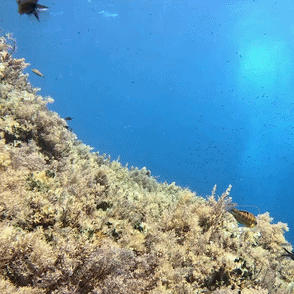

### Hi, I'm Dolapo Salim Olatoye

Here you will find experiments, half-finished ideas and the occasional *"what was I thinking?"* commit. Science is messy.

💡 **More about me:** [on my personal website](https://dolaposalim.com/)

<h3 align="center">Featured Research</h3>

<h4 align="center">Coral Reef Tipping Points</h4>

A coral–seaweed–herbivore model built with synthetic data to test how scientists detect reef tipping points, early warnings and recovery.

  
  
  

<h3 align="center">Selected Projects</h3>

| Project | What it does |
|---|---|
| [**marineAnnotate**](https://github.com/DolapoSalim/marineAnnotate) | Annotation tool for marine ecology imagery: bounding boxes, segmentation masks, keypoints and classification for fish, coral, benthic habitats and macroalgae |
| [**EcoQuad**](https://github.com/DolapoSalim/EcoQuad) | AI tool that analyses photoquadrat images to measure species presence and percentage cover (in development) |
| [**GraphRAG-MarineMind**](https://github.com/DolapoSalim/GraphRAG-MarineMind) | Deterministic Graph-RAG system for interpreting imaging-based ecological variables and environmental monitoring data |
| [**package-for-fish-behavior-analysis**](https://github.com/DolapoSalim/package-for-fish-behavior-analysis) | Toolkit for analysing fish behaviour in video recordings with optical flow and computer vision |
| [**web-based-macroalgae-active-learner**](https://github.com/DolapoSalim/web-based-macroalgae-active-learner) | Streamlit app that segments macroalgae in underwater images with YOLO + SAM models and reports percentage cover by class |

<h3 align="center">Featured Computer Vision Project</h3>

<h4 align="center">Automated Fish Tracking</h4>

  

AI-powered fish detection and multi-object tracking for ecological and behavioural analysis.

<h3 align="center">AI, Computer Vision & Research Tools</h3>

  
  
  
  
  
  
  
  
  
  
  
  
  
  
  
  

<h3 align="center">Coding Activity</h3>

  

Open to collaboration on reef ecology, marine imaging and ecological AI: open an issue on any repo or reach out via my website.

